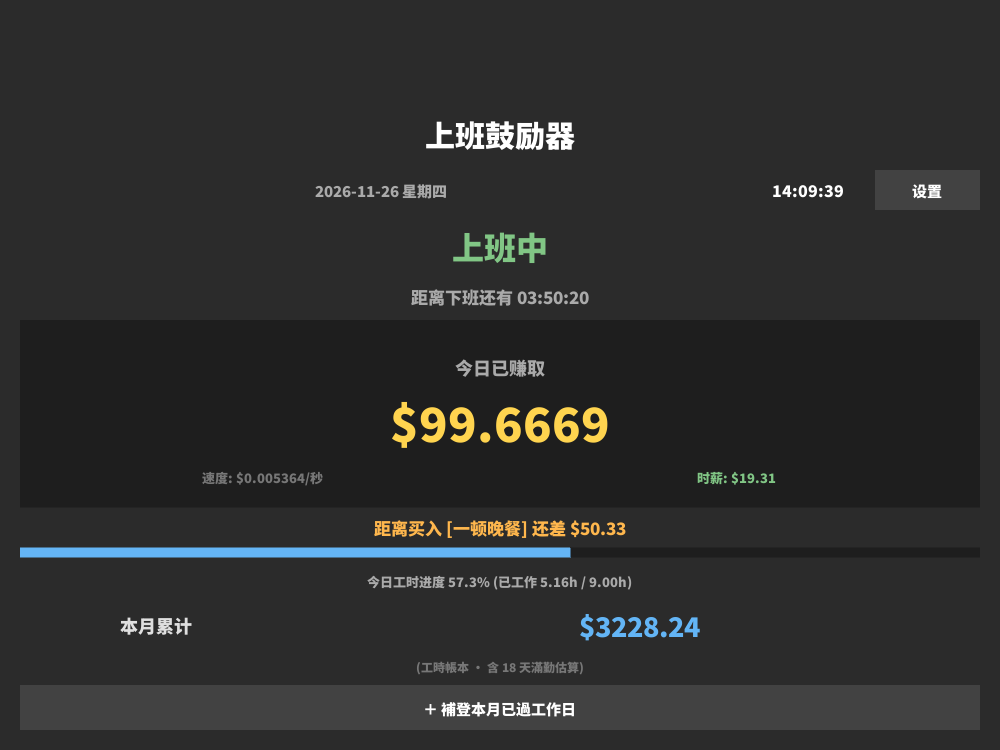

# 上班鼓励器（Android / Kivy）

把「上班鼓勵器」做成手機 App：以月薪、工時推算每秒收入，即時顯示今日已賺、今日工時進度與本月累計。

原版是 Windows 桌面程式（Tkinter）。Tkinter 無法打包成 APK，所以介面層改用 Kivy，
計算與儲存邏輯與桌面版共用同一套規則。



## 功能

- 每秒更新的收入數字、時速、時薪
- 五段狀態：未上班 / 上午上班 / 午休 / 下午上班 / 已下班
- 心願目標：顯示下一個買得起的目標還差多少
- 本月累計：已記錄的日子用實際秒數，沒記錄的過去平日按滿勤補上
- 設定持久化：`config.json`（設定）與 `ledger.json`（每日工時帳本）
- 資料存在 App 私有目錄，不需要任何 Android 權限

## 在電腦上先預覽

```bash
pip install kivy==2.3.2
python main.py
```

先跑一次邏輯自我檢查：

```bash
python selftest_core.py
```

## 打包 APK

三種方式（GitHub Actions / WSL2 / Docker）與常見錯誤排除，見 [README_APK.md](README_APK.md)。

最快的做法是推上 GitHub，讓 `.github/workflows/build-apk.yml` 自動編譯，
到 Actions 的 Artifacts 下載 `.apk`，不需要在本機安裝 Android SDK。

## 檔案

| 檔案 | 說明 |
|---|---|
| `main.py` | Kivy 介面（主畫面 + 設定畫面） |
| `core.py` | 純邏輯：工時曲線、費率、設定、工時帳本 |
| `selftest_core.py` | 不需 Android 的自我檢查 |
| `buildozer.spec` | Buildozer 打包設定 |
| `NotoSansSC-Regular.ttf` | 中文字型（Noto Sans SC，OFL 授權） |
